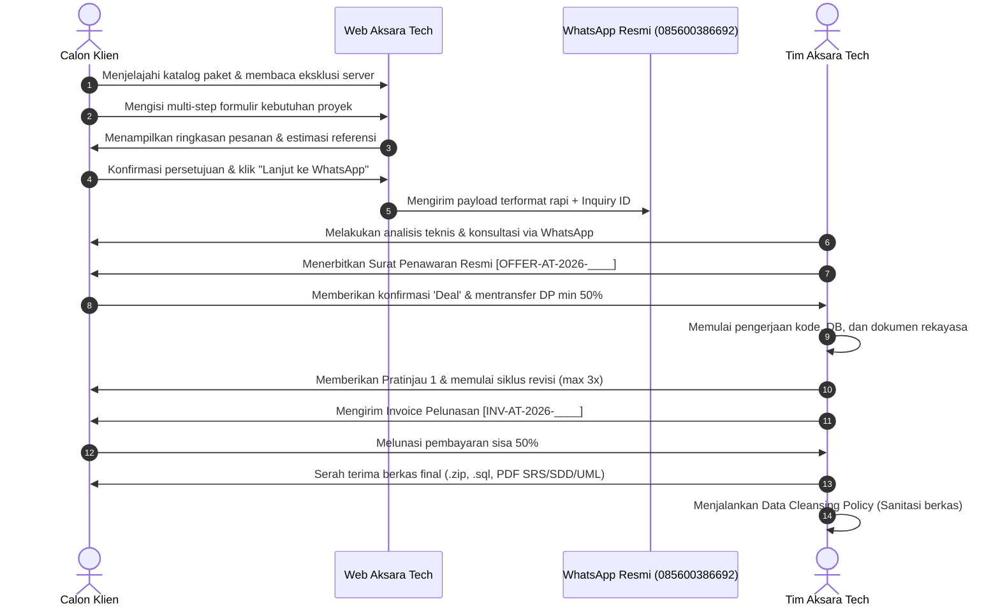
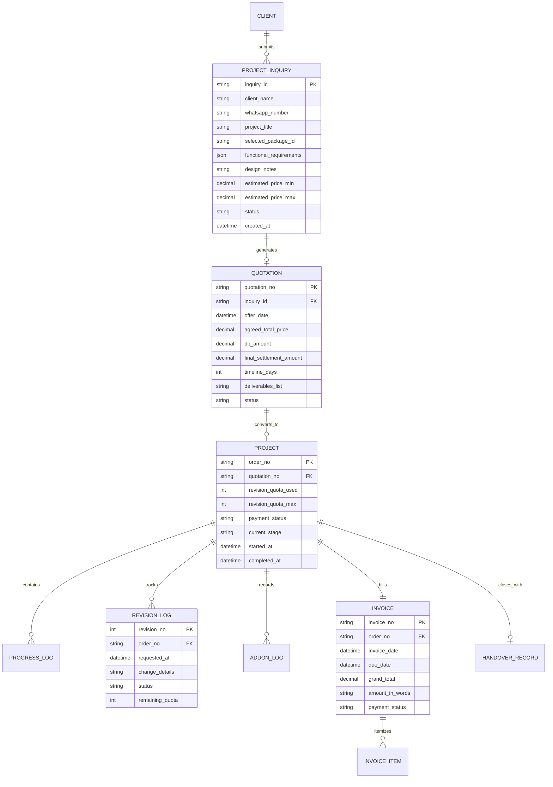

# PRODUCT REQUIREMENTS DOCUMENT (PRD)
## AKSARA TECH — Enterprise Digital Solutions & Software Engineering
**Document Identifier:** `PRD-AT-2026-001`  
**Classification:** Single Source of Truth (SSOT) — Master Product Specification  

---

## 1. Document Metadata & Version History

| Metadata Field | Specification Details |
|---|---|
| **Project Name** | Aksara Tech Official Web Platform & Order Administration System |
| **Document Version** | v1.0.0 (Comprehensive Baseline Specification) |
| **Document Status** | Approved for Discovery & Planning Baseline |
| **Lead Product Manager** | Senior Product Manager & Business Analyst Team |
| **Official Business Entity** | AKSARA TECH — Enterprise Digital Solutions & Software Engineering |
| **Official Corporate Support** | WhatsApp: `085600386692` |
| **File Location** | `scratch/aksara-tech/PRD.md` |
| **Target Completion Baseline** | Enterprise Standard Multi-Phase Rollout |

### Revision History
| Version | Date | Author | Description of Changes | Status |
|---|---|---|---|---|
| v0.1.0 | 2026-10-28 | PM Team | Initial extraction and summary from 5 source business documents. | Superseded |
| v1.0.0 | 2026-10-28 | PM & Arch Team | Expansion into complete 40-section formal PRD structure, tagging all requirements with MoSCoW and verification status. | Confirmed Baseline |

---

## 2. Executive Summary
AKSARA TECH adalah penyedia layanan rekayasa perangkat lunak dan solusi digital (*Enterprise Digital Solutions & Software Engineering*). Produk yang dirancang merupakan ekosistem terpadu yang memadukan **Website Publik Interaktif** (menampilkan 5 paket utama, kalkulator harga referensi, penegasan eksklusi server, serta formulir pengumpulan kebutuhan proyek bertahap / *progressive disclosure*) dengan **Sistem Administrasi & Operasional Proyek** (pipeline otomatis untuk pembuatan draft Surat Penawaran, Dokumen Persetujuan, Invoice, pelacakan kuota 3 kali revisi mutlak, pencatatan add-on, evaluasi QA, serta protokol serah terima berkas).

---

## 3. Business Context
Penyelenggaraan jasa rekayasa perangkat lunak mandiri sering kali menghadapi tantangan mendasar:
1. Calon klien mengontak tanpa spesifikasi yang matang sehingga membutuhkan waktu konsultasi manual yang panjang.
2. Sering terjadi kesalahpahaman ruang lingkup (*scope creep*), khususnya anggapan bahwa jasa pembuatan web mencakup pembelian nama domain, sewa hosting, atau pemeliharaan server pihak ketiga.
3. Inkonsistensi data administratif akibat penginputan data secara terpisah pada brief, penawaran harga, lembar kendali revisi, dan invoice tagihan.

Platform ini hadir untuk mendisiplinkan alur bisnis, memberikan transparansi penuh, melindungi margin usaha dengan batas kuota revisi yang jelas, dan mengeliminasi friksi administratif.

---

## 4. Problem Statement
- **Bagi Calon Klien:** Kesulitan memperkirakan kisaran biaya proyek, bingung memilih spesifikasi teknis yang tepat untuk kebutuhan mereka, serta minimnya transparansi terkait hak revisi dan batasan layanan.
- **Bagi Manajemen Aksara Tech:** Terlalu banyak waktu tersita untuk menyalin data teknis yang sama berulang kali ke berbagai dokumen formal, kesulitan memantau sisa kuota revisi klien secara transparan, serta risiko perselisihan terkait tanggung jawab server.

---

## 5. Product Vision
Mewujudkan website korporat AKSARA TECH yang berkelas eksekutif, modern, berkinerja tinggi, dan terpercaya, yang tidak hanya memikat calon klien pada pandangan pertama, tetapi juga berfungsi sebagai mesin penyaring (*qualification engine*) yang sistematis, mengubah brief calon klien menjadi data terstruktur yang siap diproses menjadi penawaran, invoice, dan rekam jejak proyek resmi.

---

## 6. Goals & Non-Goals

### High-Level Goals
1. Menampilkan profil, 5 paket layanan utama, 10 modul add-on, dan standar teknologi resmi AKSARA TECH secara profesional.
2. Memfasilitasi calon klien untuk mengisi formulir spesifikasi kebutuhan proyek (*brief teknis*) sebelum terhubung ke saluran resmi WhatsApp `085600386692`.
3. Memastikan pemahaman mutlak atas **Kebijakan Eksklusi Server** sebelum transaksi terjadi.
4. Menghubungkan data formulir secara mulus ke pembuatan dokumen administratif (Penawaran, Invoice, Lembar Kendali Order) tanpa redundansi input.
5. Menyediakan mekanisme kontrol kuota revisi maksimal 3 kali mutlak secara transparan.

### Non-Goals (Explicit Boundaries)
1. **Bukan Hosting Provider:** Sistem TIDAK menjual domain, TIDAK menyewakan server hosting, dan TIDAK melayani konfigurasi server publik.
2. **Bukan Payment Gateway Instan Mandiri:** Sistem tidak melakukan auto-debit atau konfirmasi pembayaran otomatis tanpa verifikasi manual tim keuangan Aksara Tech via WhatsApp resmi.
3. **Bukan Registrasi Akun Publik Terbuka:** Calon klien tidak diwajibkan mendaftar akun/kata sandi hanya untuk meninjau paket atau mengisi formulir kebutuhan.

---

## 7. Success Metrics

| Metric Category | Target Indicator | Baseline Measurement |
|---|---|---|
| **Lead Qualification** | 100% lead yang masuk ke WhatsApp membawa format pesan terstruktur & Inquiry ID | Sebelumnya pesan masuk tidak terstruktur |
| **Brief Completion Rate** | >= 70% pengguna yang membuka formulir menyelesaikannya hingga tahap ringkasan | Minimal friksi berkat *progressive disclosure* |
| **Scope Dispute Incidents** | 0 kasus perselisihan tanggung jawab server hosting/domain | Edukasi eksplisit di landing page & formulir |
| **Admin Drafting Efficiency** | Reduksi waktu pembuatan dokumen administratif >= 75% | Data terisi otomatis dari payload formulir |

---

## 8. Stakeholders

| Stakeholder Role | Tanggung Jawab Utama | Kepentingan dalam Sistem |
|---|---|---|
| **Pemilik Usaha / Tech Lead** | Validasi arsitektur teknis, approval penawaran, eksekusi kode | Memastikan kepatuhan aturan bisnis & keakuratan teknis |
| **Project Manager / Admin** | Koordinasi klien via WhatsApp, pemantauan timeline & revisi | Efisiensi administrasi dokumen & kepastian alur kerja |
| **Calon Klien UMKM / Korporat** | Pemesan website bisnis, landing page, atau toko online | Kemudahan pemahaman harga, kepastian jadwal, & profesionalisme |
| **Calon Klien Mahasiswa** | Pemesan modul akademik / tugas akhir & dokumen rekayasa | Kebutuhan dokumen IEEE (SRS/SDD), UML, & plafon biaya terjangkau |

---

## 9. User Personas

### Persona 1: Rian (Mahasiswa Tingkat Akhir Teknik Informatika)
- **Karakter:** Membutuhkan sistem web dinamis untuk skripsi dengan arsitektur modern (MVC/Laravel/NestJS) beserta dokumen lengkap IEEE (SRS, SDD) dan UML Diagram.
- **Kebutuhan Utama:** Kepastian harga tidak melebihi plafon mahasiswa (maks Rp 650.000) dan jadwal selesai dalam 5–10 hari kerja.
- **Pain Point:** Sering kesulitan menyusun dokumen rekayasa formal dan diagram sistem secara rapi.

### Persona 2: Pak Bambang (Pemilik Usaha Retail & Manufaktur Lokal)
- **Karakter:** Ingin memperluas jangkauan pasar dengan website katalog produk digital atau toko online dengan tombol WhatsApp otomatis.
- **Kebutuhan Utama:** Tampilan mobile yang cepat, navigasi simpel, harga terjangkau (Rp 200rb – Rp 380rb), dan alur transaksi yang jelas.
- **Pain Point:** Tidak mengerti urusan teknis server/hosting dan khawatir dikenakan biaya-biaya tersembunyi.

### Persona 3: Ibu Maya (Corporate Secretary / Agency Lead)
- **Karakter:** Memerlukan Company Profile Korporat berstandar eksekutif untuk memperkuat kredibilitas perusahaan di hadapan investor/klien.
- **Kebutuhan Utama:** Dokumen penawaran harga resmi (*Quotation*), Invoice berstatus resmi, kepatuhan batas kuota revisi, serta jaminan kerahasiaan data 100%.

---

## 10. Business Rules (Terverifikasi Penuh dari Dokumen Sumber)

```
[BR-PKG-001] Rentang Tarif & Waktu Paket Utama:
             - Landing Page Korporat: Rp 120.000 – Rp 250.000 | 3–5 Hari Kerja
             - Website UMKM & Katalog: Rp 200.000 – Rp 380.000 | 4–7 Hari Kerja
             - Company Profile Korporat: Rp 280.000 – Rp 480.000 | 5–8 Hari Kerja
             - E-Commerce / Toko Daring: Rp 350.000 – Rp 580.000 | 6–9 Hari Kerja
             - Tugas Akhir / Skripsi: Rp 350.000 – Rp 650.000 | 5–10 Hari Kerja

[BR-ADD-001] Daftar Tarif Resmi Layanan Tambahan (Add-on):
             - SRS & SDD Tambahan: Rp 100.000 – Rp 150.000
             - UML & Diagram Sistem: Rp 100.000 – Rp 150.000
             - Halaman Baru Tambahan: Rp 50.000 / halaman
             - Optimasi SEO On-Page: Rp 75.000 – Rp 100.000
             - Fitur Multi-Bahasa: Rp 100.000 – Rp 150.000
             - Integrasi Database & CRUD: Rp 100.000 – Rp 150.000
             - Custom Modul Khusus: Rp 100.000 – Rp 150.000
             - Autentikasi Login & Multi-Role: Rp 100.000 – Rp 150.000
             - Payment Gateway Otomatis: Rp 100.000 – Rp 150.000
             - Software Maintenance Koding Harian: Rp 50.000 / hari kerja

[BR-REV-001] Kebijakan Kuota Revisi Maksimal 3 Kali Mutlak:
             - Setiap paket include maksimal 3 (tiga) kali kuota revisi setelah preview pertama.
             - Berlaku merata tanpa membedakan minor maupun mayor.
             - Seluruh poin revisi wajib disampaikan tertulis dalam satu daftar poin (*revision list*).
             - Pengajuan revisi setelah kuota ke-3 habis otomatis dialihkan ke Add-on berbayar.

[BR-PAY-001] Skema Finansial & Pembayaran Termin:
             - Pembayaran dibagi 2 termin resmi: Uang Muka (DP) min 50% dan Pelunasan 50%.
             - DP bersifat non-refundable jika pembatalan sepihak terjadi setelah koding dimulai.
             - Sisa pelunasan 50% wajib diselesaikan sebelum penyerahan master berkas final.

[BR-SRV-001] Ketentuan Eksklusi Layanan Server:
             - AKSARA TECH secara mutlak TIDAK menyediakan pembelian domain, sewa hosting,
               konfigurasi cPanel/VPS/Cloud, upload deployment publik, atau maintenance server fisik/cloud.
             - Software maintenance murni berfokus pada perbaikan bug kode dan rekayasa program.

[BR-SEC-001] Kerahasiaan Data & Kebijakan Sanitasi:
             - Jaminan kerahasiaan 100% atas materi, identitas, dan kode sumber klien.
             - Penerapan Data Cleansing Policy (pembersihan data internal) pasca serah terima lunas.

[BR-COM-001] Saluran Komunikasi Tunggal Resmi:
             - Seluruh kesepakatan, penawaran, dan serah terima wajib melalui WhatsApp `085600386692`.
```

---

## 11. Source Document Mapping

| Dokumen Sumber | Bagian yang Diadopsi | Modul Target dalam Sistem |
|---|---|---|
| `katalog.docx` | Paket, estimasi, rentang harga, deliverables, tech stack, add-on 1-10 | Modul Showcase Paket, Selector Add-on, Price Calculation Logic |
| `penawaran.docx` | Header surat penawaran, spesifikasi teknis, klausul validasi digital WA | Generator Draft Penawaran (`[OFFER-AT-2026-____]`) |
| `invoice.docx` | Rincian modul, grand total, format terbilang, syarat serah terima lunas | Generator Draft Invoice (`[INV-AT-2026-____]`) |
| `terms_baru.docx` | SOP 4 tahap, eksklusi server, batasan 3 revisi, kebijakan privasi | Legal Terms Page, Checkbox Persetujuan Form, Disclaimer Banner |
| `catatan.docx` | Format log kendali, tracker kuota revisi (1 s/d 3), log add-on, QA checklist | Lembar Kendali Internal (`[ORD-AT-2026-____]`) |

---

## 12. Document Conflicts & Decisions

1. **Plafon Tarif Rp 650.000 vs Akumulasi Add-on:**
   - *Analisis:* Katalog mencantumkan plafon resmi Rp 650.000 (pada paket tertinggi: Tugas Akhir). Namun invoice contoh memuat paket Rp 450.000 + Add-on Rp 200.000 = Rp 650.000.
   - *Keputusan:* Plafon Rp 650.000 adalah batas atas untuk **Paket Utama Mandiri** (Tugas Akhir/Skripsi). Layanan tambahan (Add-on No. 1–10) yang diminta secara spesifik oleh klien dihitung transparan di atas paket dasar sesuai kesepakatan penawaran.
   - *Status:* `Confirmed`.
2. **Kesesuaian Deliverables Dokumen Rekayasa:**
   - *Analisis:* Template penawaran umum menuliskan deliverables include SRS/SDD/UML, padahal paket Landing Page dan Company Profile bersifat bebas dokumen rekayasa bawaan.
   - *Keputusan:* Deliverables dokumen rekayasa disesuaikan secara dinamis pada dokumen penawaran berdasarkan paket pilihan (hanya otomatis include untuk Paket 2, 4, 5 atau jika Add-on dokumen dipilih).
   - *Status:* `Confirmed`.
3. **Validasi Persetujuan Resmi:**
   - *Analisis:* Dokumen menekankan persetujuan via WhatsApp konfirmasi tertulis ('Deal' / transfer DP).
   - *Keputusan:* Validasi WhatsApp ke `085600386692` tetap menjadi landasan legal transaksi utama. Portal web menyediakan kode verifikasi/ID unik (`INQ-AT-YYYYMMDD-XXXX`) untuk mempercepat verifikasi.
   - *Status:* `Confirmed`.
4. **Scope Arsitektur MVP (Phase 2 Discovery Decision):**
   - *Analisis:* Kebutuhan peluncuran cepat vs sistem administrasi terintegrasi.
   - *Keputusan:* Diadopsi **Opsi A+ (Enterprise Public Website + Smart Progressive Disclosure Form + WhatsApp Direct Engine + Admin Document Drafting Module)**. Data formulir disimpan di client-side state/local persistence dengan arsitektur data model yang 100% siap ditransisikan ke Backend API & Database terpusat pada fase berikutnya.
   - *Status:* `Confirmed`.

---

## 13. Product Scope

### In-Scope (Phase 1 MVP Release)
- **Portal Publik Modern:**
  - Hero section dengan value proposition & branding "Enterprise Digital Solutions & Software Engineering".
  - Banner penegasan resmi *Server Exclusion Policy* yang mencolok dan edukatif.
  - Showcase interaktif 5 Paket Layanan dengan perbandingan fitur, estimasi waktu (3–10 hari), rentang harga resmi, dan deliverables.
  - Showcase 10 Modul Add-on & Software Maintenance koding harian (Rp 50.000/hari).
  - Halaman Ketentuan Layanan & Kebijakan Privasi (sesuai dokumen `terms_baru`).
  - Halaman FAQ komprehensif.
- **Formulir Kebutuhan Proyek Cerdas (Progressive Disclosure):**
  - Tahap 1: Data Klien & Kontak (Nama, WhatsApp aktif, Email opsional, Nama Proyek).
  - Tahap 2: Pemilihan Paket Utama (1 dari 5 paket).
  - Tahap 3: Tujuan & Sasaran Proyek (Bisnis, UMKM, Organisasi, Akademik).
  - Tahap 4: Spesifikasi Fungsional Kondisional (Database, Auth, Dokumen SRS/SDD/UML).
  - Tahap 5: Desain & Ketersediaan Aset (Referensi, Warna, Logo, Konten teks).
  - Tahap 6: Permintaan Tambahan / Add-on.
  - Tahap 7: Ringkasan Pesanan & Pernyataan Persetujuan Awal.
  - Action Button: Generate Payload & Direct to WhatsApp `085600386692`.
- **Administrative Drafting Module (Order, Quotation, Invoice):**
  - Generator format Surat Penawaran resmi (`OFFER-AT-2026-____`).
  - Generator format Invoice resmi (`INV-AT-2026-____`) lengkap dengan kalkulator terbilang rupiah otomatis.
  - Generator format Lembar Kendali Catatan Order & Tracker 3x Kuota Revisi (`ORD-AT-2026-____`).
  - Mode Pratinjau Dokumen & Print/PDF ready stylesheet.

### Out of Scope (Explicitly Excluded)
- Pembayaran kartu kredit/payment gateway otomatis langsung tanpa verifikasi manual.
- Modul hosting, domain DNS manager, atau FTP deployment tool.
- Sistem keanggotaan publik (User Registration/Login untuk calon klien).

---

## 14. Out of Scope (Release Beyond MVP)
- Integrasi bot WhatsApp otomatis dua arah (webhook auto-reply).
- Sistem tanda tangan digital bersertifikat (BSrE/DocuSign).

---

## 15. User Stories

| ID | As a... | I want to... | So that... | Priority |
|---|---|---|---|---|
| `US-PUB-01` | Calon Klien | Meninjau 5 paket layanan lengkap dengan harga referensi dan estimasi waktu | Saya dapat memilih paket yang sesuai dengan kebutuhan dan anggaran saya | Must Have |
| `US-PUB-02` | Calon Klien | Mengetahui secara jelas batasan layanan (eksklusi server) sejak awal | Saya tidak salah paham mengenai kebutuhan sewa hosting dan pembelian domain | Must Have |
| `US-FRM-01` | Calon Klien | Mengisi formulir kebutuhan proyek secara bertahap yang hanya menanyakan hal relevan | Pengisian formulir terasa mudah, cepat, dan tidak membingungkan | Must Have |
| `US-FRM-02` | Calon Klien | Melihat ringkasan kebutuhan beserta estimasi biaya sebelum diarahkan ke WhatsApp | Saya dapat memeriksa kembali kebenaran data saya sebelum berkonsultasi resmi | Must Have |
| `US-ADM-01` | Admin Aksara | Menerima data kebutuhan calon klien dalam format rapi via WhatsApp | Saya tidak perlu menanyakan ulang pertanyaan mendasar satu per satu | Must Have |
| `US-ADM-02` | Admin Aksara | Membuat draf Surat Penawaran resmi dari data pesanan tanpa mengetik ulang | Penerbitan penawaran harga menjadi cepat, presisi, dan konsisten | Should Have |
| `US-ADM-03` | Admin Aksara | Melacak penggunaan kuota revisi proyek (maks 3 kali mutlak) secara transparan | Sisa kuota terpantau jelas dan klien terinformasi jika revisi berikutnya berbayar | Should Have |
| `US-ADM-04` | Admin Aksara | Menerbitkan Invoice resmi lengkap dengan subtotal paket, add-on, dan terbilang | Penagihan termin DP dan pelunasan tercatat secara profesional | Should Have |

---

## 16. Sitemap & Information Architecture

```
Website Aksara Tech
├── [1.0] Beranda (Home)
│   ├── Hero Section & Value Proposition
│   ├── Server Exclusion Alert Banner
│   ├── Alur Kerja 4 Tahap (SOP)
│   ├── Showcase 5 Paket Utama
│   ├── Showcase 10 Add-on & Software Maintenance
│   ├── Tech Stack Resmi (Next.js, Laravel, NestJS, MySQL, dll.)
│   ├── Mengapa Aksara Tech (Jaminan 100% Confidentiality & Kualitas)
│   └── Call to Action (CTA) ke Formulir
├── [2.0] Formulir Pemesanan & Kebutuhan Proyek (Briefing Engine)
│   ├── Step 1: Informasi Klien & Kontak
│   ├── Step 2: Pemilihan Paket Layanan
│   ├── Step 3: Tujuan & Target Sistem
│   ├── Step 4: Kebutuhan Fitur & Spesifikasi Teknis
│   ├── Step 5: Preferensi Desain & Kesiapan Aset
│   ├── Step 6: Permintaan Tambahan / Add-on
│   └── Step 7: Ringkasan Pesanan & Kirim ke WhatsApp Resmi
├── [3.0] Ketentuan Layanan & Privasi (Terms & Privacy)
│   ├── Landasan Hukum & Prosedur Operasional
│   ├── Ruang Lingkup Maintenance & Eksklusi Server
│   ├── Kebijakan Kerahasiaan & Sanitasi Data (Data Cleansing)
│   └── Kebijakan Kuota 3 Kali Revisi & Skema Pembayaran
├── [4.0] Tanya Jawab Resmi (FAQ)
└── [5.0] Internal Portal / Document Generator (Admin Tools)
    ├── Drafting Penawaran Harga (Quotation Generator)
    ├── Drafting Invoice Resmi (Invoice Generator)
    └── Tracking Proyek & Kontrol Kuota Revisi (Project Control Sheet)
```

---

## 17. User Journeys



---

## 18. Functional Requirements (FR)

### Modul Publik & Navigasi
- `FR-NAV-001` [Must Have] [Confirmed]: Menyediakan menu navigasi responsif: Layanan & Paket, Add-on, Eksklusi Server, Ketentuan Layanan, FAQ, dan Tombol CTA "Mulai Konsultasi / Pesan".
- `FR-PKG-001` [Must Have] [Confirmed]: Menampilkan kartu 5 paket utama dengan rincian fitur terstruktur, estimasi durasi (3–10 hari kerja), rentang harga resmi, dan deliverables.
- `FR-BNR-001` [Must Have] [Confirmed]: Menampilkan banner peringatan eksplisit mengenai batasan eksklusi server (tidak termasuk hosting, domain, deployment, atau penanganan server down).

### Modul Formulir Kebutuhan
- `FR-FRM-001` [Must Have] [Confirmed]: Multi-step form terstruktur 7 langkah dengan indikator kemajuan (*step indicator*).
- `FR-FRM-002` [Must Have] [Confirmed]: Validasi input wajib (Nama, WhatsApp Indonesia valid `08xx`, nama proyek, paket utama).
- `FR-FRM-003` [Must Have] [Confirmed]: Logika kondisional (*Progressive Disclosure*): pertanyaan kebutuhan dokumen SRS/SDD/UML hanya muncul jika paket yang dipilih adalah Tugas Akhir atau jika klien memilih add-on dokumen.
- `FR-FRM-004` [Must Have] [Confirmed]: Penyimpanan draf formulir sementara (*client-side state*) agar data tidak hilang saat pengguna berpindah langkah atau me-refresh halaman.
- `FR-FRM-005` [Must Have] [Confirmed]: Halaman ringkasan interaktif sebelum pengiriman yang menampilkan rincian kontak, paket terpilih, estimasi biaya referensi, estimasi waktu pengerjaan, dan klausul persetujuan.
- `FR-FRM-006` [Must Have] [Confirmed]: Pembuatan kode identitas unik `INQ-AT-YYYYMMDD-XXXX` untuk setiap ringkasan pesanan.
- `FR-FRM-007` [Must Have] [Confirmed]: Tombol aksi pengiriman yang menyusun teks terformat rapi dan langsung membuka percakapan ke WhatsApp resmi `085600386692`.

---

## 19. Form Requirements Matrix

| Step | Bagian Formulir | Field Input | Tipe Input | Aturan Validasi |
|---|---|---|---|---|
| 1 | Informasi Klien | Nama Klien / Instansi | Text | Wajib, min 3 karakter |
| 1 | Informasi Klien | Nomor WhatsApp Aktif | Tel | Wajib, format standar Indonesia (`08...`) |
| 1 | Informasi Klien | Alamat Email | Email | Opsional |
| 1 | Informasi Klien | Nama Proyek Website | Text | Wajib, min 5 karakter |
| 2 | Pemilihan Paket | Pilihan 1 dari 5 Paket Utama | Radio Cards | Wajib memilih 1 paket |
| 3 | Tujuan Proyek | Kategori Penggunaan (Bisnis, UMKM, Personal, Tugas Akhir) | Select / Pills | Wajib |
| 3 | Tujuan Proyek | Deskripsi Singkat Tujuan Sistem | Textarea | Wajib, min 20 karakter |
| 4 | Fungsionalitas | Kebutuhan Fitur Spesifik (Database, Auth, Dokumen Rekayasa) | Checkbox Group | Dinamis sesuai paket |
| 5 | Desain & Materi | Kesiapan Materi (Logo, Teks Konten, Gambar) | Select | Wajib |
| 5 | Desain & Materi | Referensi / Gaya Desain yang Diinginkan | Textarea | Opsional |
| 6 | Add-on & Catatan | Pilihan Modul Add-on Tambahan (1 s/d 10) | Checkbox Group | Opsional |
| 6 | Add-on & Catatan | Catatan Teknis Tambahan | Textarea | Opsional |
| 7 | Ringkasan & Submit | Checkbox Persetujuan Awal & Kebijakan Eksklusi Server | Checkbox | Wajib dicentang |

---

## 20. Service Catalog & Pricing

```
+-----------------------------------------------------------------------------------------+
|                                    KATALOG PAKET UTAMA                                  |
+------------------------------------------------+-------------------+--------------------+
| Paket Layanan                                  | Estimasi Waktu    | Rentang Tarif      |
+------------------------------------------------+-------------------+--------------------+
| 1. Landing Page Korporat (Statis, High Conv)   | 3 - 5 Hari Kerja  | Rp 120rb - Rp 250rb|
| 2. Website UMKM & Katalog Digital (Dinamis DB) | 4 - 7 Hari Kerja  | Rp 200rb - Rp 380rb|
| 3. Company Profile Korporat (Semi-Dinamis)     | 5 - 8 Hari Kerja  | Rp 280rb - Rp 480rb|
| 4. E-Commerce / Toko Daring (Checkout WA API)  | 6 - 9 Hari Kerja  | Rp 350rb - Rp 580rb|
| 5. Tugas Akhir / Skripsi (Full UML & SRS/SDD)  | 5 - 10 Hari Kerja | Rp 350rb - Rp 650rb|
+------------------------------------------------+-------------------+--------------------+
```

---

## 21. Quotation & Contract Workflow

1. Data dari inquiry klien diterima melalui WhatsApp `085600386692`.
2. Admin memverifikasi kelayakan teknis dan menentukan harga final yang disepakati (masih di dalam rentang katalog).
3. Generator Dokumen menerbitkan **Surat Penawaran Harga & Lingkup Pekerjaan** resmi dengan format:
   - Nomor Referensi: `OFFER-AT-2026-XXXX`
   - Identitas Klien & Proyek
   - Spesifikasi Teknis & Tech Stack yang disepakati
   - Deliverables Rinci (disertai status SRS/SDD/UML jika berlaku)
   - Nilai Pengerjaan, Termin DP 50%, dan Pelunasan 50%
   - Estimasi Penyelesaian & Kuota Revisi Maksimal 3 Kali Mutlak
   - Klausul Validasi Digital via WhatsApp Resmi.
4. Klien memberikan konfirmasi tertulis ('Deal' / 'Setuju') atau bukti transfer DP min 50%.

---

## 22. Invoice & Payment Workflow

1. Saat DP disetujui, diterbitkan Invoice Termin DP (status: DP LUNAS).
2. Setelah pengerjaan selesai, preview disetujui, dan uji QA tuntas, diterbitkan **Invoice Pelunasan**:
   - Nomor Invoice: `INV-AT-2026-XXXX`
   - Tanggal & Tanggal Jatuh Tempo
   - Rincian Paket Utama + Rincian Add-on yang ditambahkan
   - Subtotal, Potongan (jika ada), dan Grand Total
   - Terbilang Otomatis (Contoh: *Enam Ratus Lima Puluh Ribu Rupiah*)
   - Status: LUNAS / BELUM LUNAS
   - Instruksi transfer via saluran resmi WA `085600386692`.
3. Verifikasi mutasi dana masuk dilakukan manual oleh pengelola keuangan Aksara Tech.

---

## 23. Admin Dashboard Requirements

- `FR-ADM-001` [Should Have] [Proposed]: Tampilan Ringkasan Metrik (Total Permintaan Masuk, Proyek Aktif, Menunggu DP, Menunggu Pelunasan).
- `FR-ADM-002` [Should Have] [Proposed]: Tabel Manajemen Permintaan (Daftar Inquiry masuk, detail jawaban form, status follow-up).
- `FR-ADM-003` [Should Have] [Proposed]: Generator Penawaran & Invoice satu klik (Auto-populate data dari Inquiry).
- `FR-ADM-004` [Should Have] [Proposed]: Fitur cetak/ekspor dokumen resmi ke format siap cetak/PDF berstandar korporat.

---

## 24. Project Management Workflow & Revision Control

Sesuai dokumen `catatan.docx`, pengelolaan pengerjaan dikontrol menggunakan lembar kendali:
- **Work Progress Log:** Pencatatan tanggal, aktivitas (Setup DB, SRS/SDD, UML, Koding CRUD, Integrasi Form), dan status hasil tindak lanjut.
- **Log Kontrol Kuota Revisi (Maksimal 3 Kali Mutlak):**
  - Revisi 1: Tanggal, Detail Penyesuaian, Status (Sisa Kuota: 2).
  - Revisi 2: Tanggal, Detail Penyesuaian, Status (Sisa Kuota: 1).
  - Revisi 3: Tanggal, Detail Penyesuaian, Status (Kuota Habis / Sisa: 0).
  - Permintaan lanjutan dialihkan ke Add-on.
- **Pencatatan Add-on:** Tanggal permintaan, nama modul, biaya tambahan, dan verifikasi WA.
- **Quality Assurance Checklist:** Pengujian fungsionalitas logika, responsivitas antarmuka, validasi database, dan kelengkapan dokumen SRS/SDD/UML.
- **Serah Terima Berkas Akhir:** Serah terima berkas Master Source Code (.zip), Skema Database (.sql), serta Dokumen Rekayasa PDF.

---

## 25. Data Requirements

Sistem mengelola data transaksional terstruktur yang mencakup:
- Informasi Kontak & Entitas Klien (Nama, Nomor WhatsApp, Email, Nama Proyek).
- Parameter Pesanan (Paket ID, Versi Paket, Kebutuhan Fungsional, Catatan Desain).
- Dokumen Administratif (Nomor Penawaran, Tanggal, Rincian Deliverables, Nilai Finansial).
- Data Tagihan (Nomor Invoice, Tanggal Jatuh Tempo, Breakdown Add-on, Status Pelunasan).
- Data Pelacakan Proyek (Log Pengerjaan, Kuota Revisi Terpakai, Status QA, Tanggal Serah Terima).

---

## 26. Data Model (Conceptual Entity-Relationship)



---

## 27. Security & Privacy

1. **Prinsip Minimalisasi Data:** Formulir hanya menghimpun data yang mutlak diperlukan untuk perancangan sistem dan komunikasi WhatsApp.
2. **Perlindungan Data Klien (100% Confidentiality):** Kode sumber, data pengujian, dan materi tugas klien tidak pernah dipublikasikan atau dibagikan ke pihak ketiga.
3. **Penerapan Data Cleansing Policy:** Berkas sensitif dan kredensial pengujian yang tersimpan di sistem internal dibersihkan secara berkala pasca proyek dinyatakan lunas dan serah terima tuntas.
4. **Input Sanitization & CSRF Protection:** Seluruh input form divalidasi dan disanitasi secara ketat untuk mencegah serangan XSS (*Cross-Site Scripting*) atau injeksi script.
5. **No Sensitive Data in Query Parameters:** Data formulir pribadi tidak boleh disebarkan secara terbuka pada URL peramban.

---

## 28. UI/UX Requirements & Brand Identity

- **Karakter Visual:** Enterprise, Modern, Presisi, Berwibawa, dan Bersih (*Executive Dark Mode with Subtle Glassmorphism & High-Contrast Typography*).
- **Palet Warna Terkurasi:**
  - Background Utama: Deep Charcoal / Slate Dark (`#0B0F17` & `#111827`)
  - Aksen Primer / Branding: Enterprise Indigo & Cyan Glow (`#4F46E5` & `#06B6D4`)
  - Aksen Sukses & Status: Emerald Green (`#10B981`)
  - Aksen Peringatan Eksklusi: Amber / Coral (`#F59E0B` & `#EF4444`)
  - Tipografi: Modern Sans-Serif (Inter / Outfit / Roboto) yang mudah dibaca pada seluruh kerapatan layar.
- **Micro-Interactions & Responsivitas:**
  - Animasi transisi halus (*smooth easing*) pada perpindahan step formulir.
  - Kartu paket dengan efek hover elegan dan penyorot paket populer (*Best Value*).
  - Tampilan sepenuhnya ramah layar sentuh (*mobile-friendly tap targets* >= 48px).

---

## 29. Non-Functional Requirements (NFR)

- `NFR-PERF-01`: Nilai Google Lighthouse Performance >= 90 pada perangkat desktop dan mobile.
- `NFR-RESP-01`: Kompatibel penuh pada breakpoint Mobile (360px–640px), Tablet (641px–1024px), dan Desktop (>1024px).
- `NFR-A11Y-01`: Rasio kontras teks minimal 4.5:1 sesuai standar WCAG 2.1 Level AA.
- `NFR-RELI-01`: Formulir mampu mempertahankan status isian pengguna di *local storage* saat terjadi gangguan koneksi internet sementara.

---

## 30. Integration Requirements

1. **WhatsApp Deep-Link Protocol:**
   - Protokol: `https://wa.me/6285600386692?text={URL_ENCODED_PAYLOAD}`
   - Payload disusun secara rapi mencakup: Header Aksara Tech, Inquiry ID unik, Identitas Klien, Paket Pilihan, Ringkasan Fitur, Estimasi Biaya Referensi, dan Pernyataan Persetujuan Awal.
2. **Document Export Engine:**
   - Standar keluaran cetak web (*Print CSS stylesheet*) yang presisi dan kompatibel untuk konversi instan ke PDF berkualitas tinggi (resolusi dokumen A4).

---

## 31. Technical Constraints

1. Lingkungan eksekusi antarmuka berjalan pada standar web modern berbasis React / Next.js / TypeScript.
2. Seluruh ketentuan tarif dan batasan waktu pengerjaan harus merujuk tepat pada data katalog tanpa modifikasi sepihak.
3. Ketergantungan server hosting pihak ketiga dihindari pada arsitektur klien sesuai batasan bisnis resmi.

---

## 32. Acceptance Criteria

- [ ] **Katalog Paket:** Seluruh 5 paket utama tampil dengan nama, harga, estimasi waktu, dan deliverables yang 100% cocok dengan dokumen `katalog.docx`.
- [ ] **Banner Eksklusi Server:** Peringatan eksklusi server tampil menonjol pada halaman depan dan sebelum pengiriman formulir.
- [ ] **Formulir Bertahap:** Seluruh 7 langkah formulir berfungsi lancar dengan validasi error yang informatif.
- [ ] **WhatsApp Payload:** Tombol kirim menghasilkan teks terformat rapi dan membuka percakapan ke nomor resmi `085600386692`.
- [ ] **Dokumen Penawaran & Invoice:** Format draft penawaran dan invoice memuat seluruh klausul resmi, nomor dokumen unik, dan format terbilang rupiah yang akurat.
- [ ] **Tracker Revisi:** Lembar kendali mencatat kuota revisi secara akurat dari kuota 3 hingga 0 dan memberi peringatan add-on.

---

## 33. Testing Strategy

1. **Unit Testing:** Pengujian fungsi kalkulator kisaran harga referensi, format terbilang rupiah (*currency-to-words engine*), dan validator format nomor WhatsApp.
2. **Form Interaction & Flow Testing:** Pengujian jalur *happy path* dan *unhappy path* (validasi field kosong, nomor tidak valid, transisi step).
3. **Cross-Browser & Responsiveness Testing:** Pengujian pada browser Chromium (Chrome/Edge), Safari (WebKit), dan Firefox di berbagai resolusi layar.
4. **WhatsApp URL Encoding Test:** Pengujian payload teks panjang agar tidak terpotong atau rusak (*malformed URI error*).

---

## 34. Analytics & Success Measurement

- Pelacakan rasio klik pada tombol "Mulai Pemesanan / Konsultasi".
- Pengukuran tingkat penurunan (*drop-off rate*) pada setiap tahapan formulir.
- Pelacakan jumlah klik konfirmasi "Lanjut ke WhatsApp".

---

## 35. Risks & Dependencies

| Risiko Potensial | Tingkat Risiko | Mitigasi yang Diterapkan |
|---|---|---|
| Klien mengabaikan ketentuan eksklusi server dan menuntut instalasi hosting publik | Sedang | Penegasan berulang melalui banner berlabel tegas serta checkbox persetujuan wajib di formulir |
| Klien menuntut revisi ke-4 tanpa biaya tambahan | Rendah | Pencatatan kuota revisi tertulis (1, 2, 3) pada lembar kendali yang dibagikan secara transparan |
| Redundansi data penawaran dan invoice | Rendah | Menggunakan data model terpusat di mana ID inquiry menjadi acuan nomor penawaran dan invoice |

---

## 36. Assumptions

1. Calon klien memiliki aplikasi WhatsApp aktif pada perangkat mobile atau desktop mereka.
2. Penentuan harga final penawaran selalu berada dalam batas rentang katalog resmi, kecuali terdapat permintaan modul kustom kompleks di luar paket standar.
3. Pembayaran Uang Muka (DP 50%) selalu diverifikasi manual sebelum kode program mulai dikerjakan.

---

## 37. Open Questions

1. **Format Ekspor Dokumen:** Apakah draf Surat Penawaran dan Invoice cukup diekspor via antarmuka cetak PDF berbasis Web View korporat, atau ada kebutuhan khusus file biner `.docx` yang dapat diedit langsung menggunakan Microsoft Word?
2. **SLA Retensi Data Sanitasi:** Berapa hari kalender pasca proyek berstatus lunas berkas internal akan dibersihkan (misal: 14 hari atau 30 hari)?

---

## 38. Prioritization (MoSCoW Matrix)

### Must Have (MVP Core)
- Landing Page korporat lengkap dengan branding Aksara Tech.
- Banner & penegasan *Server Exclusion Policy*.
- Tampilan 5 Paket Layanan & 10 Add-on sesuai katalog.
- Formulir Kebutuhan Proyek Cerdas multi-step (*progressive disclosure*).
- Ringkasan pesanan interaktif dan WhatsApp Direct Bridge (`085600386692`).
- Halaman Ketentuan Layanan & Kebijakan Privasi (Terms & Privacy).

### Should Have (Release 1.1)
- Generator Draf Surat Penawaran Resmi berstandar eksekutif.
- Generator Draf Invoice Resmi dengan kalkulator terbilang otomatis.
- Lembar Kendali Order Internal dengan tracker kuota 3x revisi.

### Could Have (Release 1.2)
- Dashboard Admin terintegrasi untuk melihat riwayat inquiry.
- Fitur ekspor langsung ke format `.docx`.

### Won't Have for This Release
- Direct payment gateway checkout tanpa validasi manual.
- Portal klien login/registrasi publik.

---

## 39. Implementation Roadmap

```
Phase 1: Document Audit & SSOT PRD.md Initialization [SELESAI]
   └── Audit 5 berkas bisnis, pemetaan konflik, perumusan 40-seksi PRD.md

Phase 2: Product Discovery & Alignment [TAHAP SAAT INI]
   └── Konfirmasi arsitektur inti & prioritas fitur

Phase 3: UI/UX & Information Architecture Design
   └── Perancangan wireframe komponen, styling design tokens, & alur form

Phase 4: Public Website MVP Implementation
   └── Bangun landing page, katalog paket, banner eksklusi, & form multi-step

Phase 5: Order Integration & WhatsApp Bridge
   └── Generator Inquiry ID, validasi form, format payload WhatsApp resmi

Phase 6: Admin Drafting Tools & Document Generators
   └── Generator Penawaran, Invoice, dan Lembar Kendali Revisi 3x

Phase 7: End-to-End Testing, Polish, & Documentation
   └── Pengujian fungsionalitas, responsivitas, dan serah terima
```

---

## 40. Release Checklist

- [ ] Seluruh aturan bisnis pada dokumen PRD telah diverifikasi terhadap dokumen sumber.
- [ ] Berkas `PRD.md` tersimpan sebagai *Single Source of Truth* di direktori proyek.
- [ ] Banner eksklusi server terintegrasi pada antarmuka.
- [ ] Nomor WhatsApp resmi `085600386692` terkonfigurasi dengan benar di seluruh saluran tombol aksi.
- [ ] Validasi form mencegah pengiriman data kosong atau format nomor telepon yang keliru.
- [ ] Format dokumen penawaran dan invoice memuat klausa legalitas dan termin finansial 50% / 50%.
