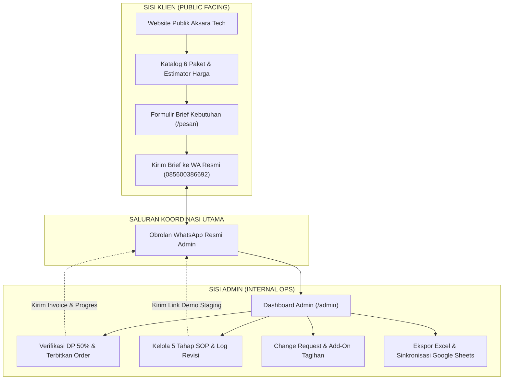

# PRODUCT REQUIREMENTS DOCUMENT (PRD) — v2.0 ROADMAP
## AKSARA TECH — Digital Solutions & Software Engineering
**Document Identifier:** `PRD-AT-2026-002`  
**Classification:** Single Source of Truth (SSOT) — Master Architecture & Product Evolution Specification  
**Status:** DRAFT PROPOSAL FOR REVIEW  
**Last Updated:** 17 November 2026  

---

## 1. Document Metadata & Version History

| Metadata Field | Specification Details |
|---|---|
| **Project Name** | Aksara Tech Web Portal & Internal Operations System |
| **Document Version** | **v2.0.0 (Public Tracker Decommissioning & Admin Core Expansion)** |
| **Document Status** | Awaiting User Review & Approval |
| **Target Architecture** | High-Touch WhatsApp Client Coordination + Executive Admin Management Hub |
| **Official Business Entity** | AKSARA TECH — Digital Solutions & Software Engineering |
| **Official WhatsApp Hotline** | `085600386692` (Format Internasional: `+62 856-0038-6692`) |
| **Production Domain** | `https://aksaratech-portal.vercel.app` |

### Revision History
| Version | Tanggal | Pembuat | Deskripsi Perubahan Utama | Status |
|---|---|---|---|---|
| **v1.0.0** | 2026-10-28 | Tim Produk | Baseline awal: Portal publik, formulir brief, public tracker `/lacak`, dan dashboard admin. | Diimplementasikan |
| **v2.0.0** | 2026-11-17 | Product Architect | **Pembaruan Arsitektur Mendatang:**<br>1. **Penghapusan Fitur Lacak Publik (`/lacak`)** untuk mengeliminasi friksi sinkronisasi antar-perangkat dan menyederhanakan pengalaman klien.<br>2. **Pemerkuatan Penuh Dashboard Admin (`/admin`)** sebagai pusat kendali operasional, verifikasi DP, kelola 5 tahap SOP, penagihan *Change Request*, invoice otomatis, dan ekspor database spreadsheet. | **Draf Usulan (Menunggu Review)** |

---

## 2. Executive Summary (Ringkasan Eksekutif)

Aksara Tech melakukan evolusi strategis pada arsitektur produk platform webnya. 

Berdasarkan evaluasi pengujian operasional di lapangan, fitur pelacakan publik mandiri oleh klien (**Public Order Tracker di `/lacak`**) menimbulkan friksi teknis (ketergantungan sinkronisasi lintas perangkat *client-side local storage* vs laptop admin tanpa database server mandiri) serta redundansi komunikasi, mengingat koordinasi riil di lapangan selalu berpusat di **WhatsApp resmi korporat**.

Oleh karena itu, pada rilis pembaruan mendatang (**v2.0**):
1. **Fitur Pelacak Publik (`/lacak`) Dihapus Total:** Navigasi ke `/lacak`, formulir pencarian tiket publik, dan parameter URL sinkronisasi pelacak ditiadakan dari pandangan klien. Klien berinteraksi melalui alur yang bersih dan mewah: membaca paket di website, mengisi formulir brief terstruktur, lalu seluruh koordinasi berkas, penawaran, update progres, dan pratinjau demo dilayani secara personal langsung di WhatsApp.
2. **Dashboard Admin (`/admin`) Dipertahankan & Ditingkatkan:** Menjadi sistem inti (*Command Center*) bagi pemilik bisnis dan tim pengembang untuk mengelola seluruh siklus hidup pesanan (*inquiry*, verifikasi DP 50%, progres tahapan SOP 1–5, kontrol kuota revisi, penambahan *Change Request*, generator berkas invoice/penawaran, telemetri Git, hingga ekspor cadangan ke Excel/Spreadsheet).

---

## 3. Justifikasi & Alasan Strategis Penghapusan Fitur Lacak Publik

```
+--------------------------------------------------------------------------------------------------+
|                                    PERBANDINGAN MODEL OPERASIONAL                                |
+--------------------------------------------------------------------------------------------------+
| MODEL LAMA (v1.0):                                                                               |
| Klien Kirim Brief -> Diberi Link /lacak?kode=... -> Klien bingung jika status belum berubah       |
| di browser HP sebelum admin kirim link update -> Muncul isu sinkronisasi local storage antar-HP. |
+--------------------------------------------------------------------------------------------------+
| MODEL BARU (v2.0 - High-Touch Executive Service):                                                |
| Klien Kirim Brief via Web -> Admin terima di WA & Dashboard -> Admin verifikasi DP di Dashboard  |
| -> Admin kirim update progres formal ke WA -> Demo live dikirim via WA -> Serah terima via WA.    |
| (Simpel, tanpa bug cache browser klien, 100% andal, terpercaya, dan terasa lebih privat/eksklusif)|
+--------------------------------------------------------------------------------------------------+
```

### Analisis Masalah di Lapangan:
1. **Friksi Klien & Ekspektasi Real-Time:** Klien yang membuka halaman website publik mengharapkan sistem pelacak otomatis layaknya kurir ekspedisi besar dengan server database terpusat yang mahal. Karena portal Aksara Tech mengusung prinsip arsitektur *Zero Monthly Server Cost* (murni frontend Vercel + Google Spreadsheet gratis), sinkronisasi data antar browser HP klien dan laptop admin memerlukan mekanisme parameter URL yang rentan membuat klien bingung.
2. **Karakteristik Pembeli Jasa Pembuatan Website:** Klien jasa pembuatan website (UMKM, pemilik bisnis, mahasiswa) lebih menyukai koordinasi langsung dan personal dengan *Project Manager* di WhatsApp, bukan memantau web dashboard publik secara mandiri.
3. **Efisiensi Kode & Performa Website:** Menghilangkan komponen pelacak publik memangkas ukuran *bundle* JavaScript publik hingga ~80 KB, mempercepat waktu muat awal website (*First Contentful Paint*), dan menyajikan navigasi portal yang lebih ringkas.

---

## 4. Visi Produk & Model Layanan Baru (The New User Journey)

### A. Alur Klien (Client Experience — Simple & Seamless)
1. **Eksplorasi Layanan:** Klien mengakses `https://aksaratech-portal.vercel.app` untuk meninjau 6 paket layanan resmi, batasan eksklusi server, alur SOP, FAQ, dan portofolio.
2. **Pengisian Brief Bertahap (`/pesan`):** Klien mengisi formulir spesifikasi kebutuhan dengan fitur *progressive disclosure* yang interaktif.
3. **Kirim ke Saluran Resmi:** Pada tahap akhir formulir, klien menekan tombol **"Kirim Brief ke WhatsApp Korporat (085600386692)"**. Pesan otomatis terformat rapi dan dikirimkan ke WhatsApp resmi admin.
4. **Koordinasi Personal Formal:** Klien menerima Surat Penawaran Harga resmi, petunjuk transfer DP 50%, laporan progres pengerjaan berkala, tautan pratinjau demo (*staging*), dan berkas *master code* (.zip) seutuhnya langsung di WhatsApp tanpa perlu membuka halaman pelacak publik.

### B. Alur Admin (Executive Dashboard — Full Operational Control)
1. **Penerimaan Pesanan:** Pesanan baru otomatis masuk ke dashboard laptop admin (via impor teks WhatsApp atau Google Sheets).
2. **Verifikasi DP 50%:** Admin menekan 1 tombol **"Verifikasi DP (50%)"**; sistem otomatis menerbitkan nomor order resmi (`ORD-AT-2026-XXX`), mengubah status menjadi **Fix Order**, dan menaikkan tahap ke Tahap 2.
3. **Eksekusi Tahapan SOP:** Admin menggeser tahapan pengerjaan (Tahap 1 sampai Tahap 5) sesuai progres riil koding.
4. **Pencatatan Kuota Revisi:** Admin mencatat log revisi klien (maksimal 3 sesi mutlak).
5. **Change Request & Add-On Tambahan:** Jika klien meminta fitur tambahan mendadak di tengah jalan, admin cukup menekan **"+ Tambah Item Add-On / Perubahan Fitur"**; total nilai investasi otomatis terkalkulasi ulang dan invoice tambahan diterbitkan.
6. **Ekspor & Arsip Data:** Admin dapat mengunduh seluruh database pesanan ke Microsoft Excel (.xls) atau menyinkronkannya dengan Google Spreadsheet cloud.

---

## 5. Rencana Dekomisi: Modul yang Akan Dihapus (*Decommissioning*)

Berikut rincian seluruh elemen yang akan dihapus dari platform publik pada pembaruan v2.0:

| No | Komponen / Elemen | Lokasi File | Tindakan Teknis |
|---|---|---|---|
| 1 | **Halaman Order Tracker** | `src/pages/OrderTrackerPage.jsx` | File dihapus / dialihkan (*redirect* otomatis ke `/pesan` jika ada yang mengakses URL `/lacak`). |
| 2 | **Rute `/lacak` di Routing** | `src/App.jsx` | Hapus deklarasi `<Route path="/lacak" ... />` dari router aplikasi. |
| 3 | **Navigasi Navbar (Desktop & Mobile)** | `src/components/organisms/Navbar.jsx` | Hapus menu item **"Lacak Proyek"** dari navigasi desktop dan mobile drawer. |
| 4 | **Navigasi Footer** | `src/components/organisms/Footer.jsx` | Hapus tautan **"Lacak Status Proyek"** dari kolom tautan cepat di footer. |
| 5 | **Tombol Cepat di Banner & Halaman Lain** | Berbagai halaman (Hero, Alur SOP, Error) | Ganti tombol menuju `/lacak` menjadi tombol konsultasi WhatsApp atau pesan proyek `/pesan`. |
| 6 | **Tautan Lacak di Format Pesan Brief WA** | `src/utils/documentEngine.js` | Hapus baris `*VIII. TAUTAN LACAK STATUS PROYEK LANGSUNG*` dari draf pesan brief teknis. |

---

## 6. Spesifikasi Sistem Operasional Admin (`/admin`) yang Dipertahankan & Ditingkatkan

Dashboard Admin tetap dipertahankan secara utuh dan menjadi aset operasional utama bagi Aksara Tech dengan kapabilitas berikut:

### 6.1. Manajemen Siklus Hidup Pesanan (Order Lifecycle Management)
* **Status Transaksi:**
  * `INQUIRY`: Calon klien konsultasi baru / formulir brief masuk (belum bayar DP).
  * `FIX ORDER AKTIF`: Pembayaran DP 50% terverifikasi, nomor order resmi aktif, pengerjaan koding berjalan.
  * `SELESAI 100%`: Pelunasan 100% diterima, berkas *master code* (.zip) diserahkan, garansi bug 7 hari aktif.
* **Alur 5 Tahap SOP Resmi Aksara Tech:**
  * **Tahap 1:** Pengumpulan Brief Teknis & Verifikasi DP 50%.
  * **Tahap 2:** Setup Arsitektur Basis Data, Skema Relasional MySQL & ERD.
  * **Tahap 3:** Koding Fitur Utama, Logika Bisnis & Antarmuka Pengguna.
  * **Tahap 4:** Pratinjau Demo Live di Staging Sandbox & Sesi Revisi SOP (Maksimal 3x).
  * **Tahap 5:** Uji Fungsi Mandiri Klien, Pelunasan 50% Akhir, & Serah Terima Master Source Code (.zip).

### 6.2. Pengendali Kuota Revisi SOP (Maksimal 3 Sesi Mutlak)
* Pencatatan nomor sesi revisi (Sesi 1, 2, dan 3) beserta tanggal dan rincian catatan revisi tertulis klien.
* Indikator status kuota visual (*Quota Counter*): Menampilkan sisa kuota aktif dan peringatan merah jika kuota telah mencapai batas maksimal 3 kali.
* Peringatan pengalihan otomatis ke *Add-on* berbayar jika klien meminta revisi di luar kuota SOP.

### 6.3. Change Request & Add-On Invoice Builder (Fitur Baru v2.0)
* Tombol **"+ Tambah Item Add-On / Perubahan Fitur"** pada modal edit pesanan.
* Pilihan penambahan standar:
  * Sesi Revisi Ekstra (+Rp 75.000)
  * Integrasi Payment Gateway (+Rp 150.000)
  * Setup Halaman Tambahan (+Rp 50.000 / halaman)
  * Custom Fitur Baru (Nilai nominal bebas sesuai kesepakatan)
* Rekalkulasi otomatis total investasi dan sisa pelunasan termin 2 secara transparan (*Zero Hidden Fees*).
* Tombol cetak / salin draf **Addendum Tagihan Perubahan Fitur** untuk dikirimkan ke WhatsApp klien.

### 6.4. Generator Dokumen & Invoice WhatsApp
* Generator draf pesan WhatsApp resmi untuk:
  * Konfirmasi Penerbitan Surat Penawaran (*Offer Quotation*).
  * Bukti Kwitansi Penerimaan Uang Muka DP 50%.
  * Laporan Berkala Progres Tahapan Pengerjaan.
  * Undangan Peninjauan Demo Live Staging.
  * Invoice Tagihan Pelunasan Akhir 50%.
  * Berita Acara Serah Terima Kode & Garansi Bebas Bug 7 Hari.

### 6.5. Integrasi Data & Ekspor Spreadsheet
* **Ekspor Microsoft Excel Resmi (.xls):** Dokumen tabel berstandar eksekutif dengan kop surat resmi Aksara Tech, lebar kolom otomatis, dan format mata uang Rupiah rapi.
* **Ekspor CSV (.csv):** Kompatibel dengan pemisah regional titik koma (`sep=;`) untuk analisis spreadsheet.
* **Google Apps Script Cloud Sync:** Koneksi sinkronisasi dua arah (*Two-Way Webhook*) untuk cadangan data otomatis di Google Sheets tanpa server berbayar.

---

## 7. Arsitektur Teknis Baru (v2.0)



### Navigasi Publik yang Disederhanakan:
| Menu Navigasi | Tautan Target | Keterangan |
|---|---|---|
| **Paket & Harga** | `/paket` | Katalog 6 paket layanan digital resmi |
| **Eksklusi Server** | `/eksklusi-server` | Batasan tanggung jawab software engineering murni |
| **Alur SOP** | `/alur-sop` | Edukasi transparansi 5 langkah kerja & kuota 3x revisi |
| **FAQ** | `/faq` | Tanya jawab teknis, garansi 7 hari, dan termin DP |
| **Ketentuan & Privasi** | `/ketentuan` | Dokumen perjanjian legal formal & kerahasiaan data |
| **Pesan Proyek (CTA)** | `/pesan` | Formulir pengumpulan brief kebutuhan proyek |
| **WA Korporat (CTA)** | `https://wa.me/6285600386692` | Saluran konsultasi langsung dengan PIC resmi |

---

## 8. Rencana Tahapan Eksekusi (Implementation Milestones)

### Fase 1: Pembersihan Antarmuka Publik (Pembersihan Menu & Tombol)
- Menghapus link menu "Lacak Proyek" dari `Navbar.jsx` (desktop nav bar & mobile drawer).
- Menghapus link "Lacak Status Proyek" dari `Footer.jsx`.
- Mengganti seluruh tombol referensi ke `/lacak` di `HeroSection.jsx`, `WorkflowSOP.jsx`, dan `TermsPrivacyPage.jsx`.

### Fase 2: Dekomisi Halaman & Pengalihan Rute (*Graceful Redirect*)
- Memperbarui `App.jsx`: Menghapus rute `/lacak` dan mengalihkannya secara aman (*redirect 301/client-side*) ke `/pesan`.
- Mengarsipkan file `OrderTrackerPage.jsx` agar kode tidak lagi menambah beban ukuran build publik.

### Fase 3: Standardisasi Pesan WhatsApp Klien
- Memperbarui `documentEngine.js`: Menghilangkan referensi URL pelacak mandiri dari pesan brief awal.
- Menyempurnakan template notifikasi progres WhatsApp admin agar fokus pada ringkasan teks dan tautan demo *staging* langsung.

### Fase 4: Pengujian & Verifikasi Kualitas (*Quality & Anti-Slop Audit*)
- Menjalankan uji build produksi: `npm run build` (wajib lolos tanpa peringatan/error).
- Menjalankan linter estetika visual: `node .agents/skills/design-taste-frontend/scripts/lint.mjs src/` (wajib 0 FAIL).
- Memastikan performa skor Google Lighthouse tetap tinggi di mobile dan desktop.

---

## 9. Kesimpulan & Langkah Selanjutnya

Dokumen PRD v2.0 ini dirancang untuk mewujudkan portal Aksara Tech yang **jauh lebih fokus, bersih, bebas friksi teknis pelacakan, dan berkelas eksekutif**, sekaligus memberikan kendali manajemen penuh bagi pemilik usaha di Dashboard Admin.

> [!NOTE]
> **Kepada Pemilik Usaha / User:**  
> Silakan baca draf PRD di atas. Jika Anda telah menyetujui arah rencana ini, beri tahu saya agar kita dapat langsung mengeksekusi penghapusan fitur lacak publik dan mengunci arsitektur baru ini ke repositori utama!
