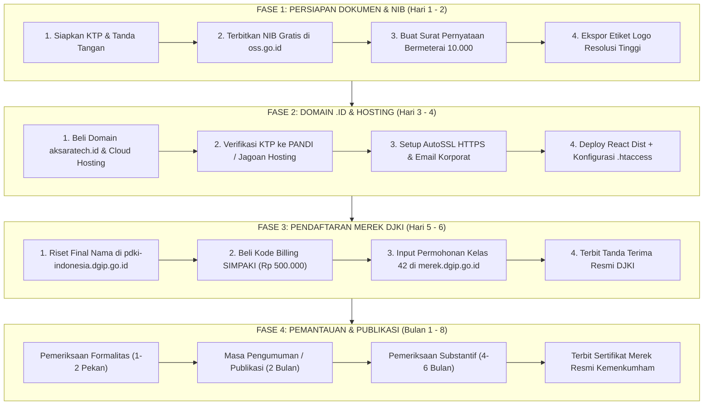

# 🧭 ROADMAP STRATEGIS: HOSTING JAGOAN HOSTING (.ID) & PENDAFTARAN MEREK RESMI (DJKI)
**Aksara Tech Enterprise Solutions — Rencana Aksi & Panduan Teknis Komprehensif**

Dokumen ini disusun sebagai panduan operasional terstruktur untuk merealisasikan dua pilar ekspansi Aksara Tech:
1. **Pilar Infrastruktur**: Migrasi & deployment portal resmi ke **Jagoan Hosting** menggunakan domain nasional berwibawa **`.id`** (`aksaratech.id`), penerbitan email korporat, dan konfigurasi server.
2. **Pilar Legalitas & Kekayaan Intelektual**: Pendaftaran resmi nama dan logo **AKSARA TECH** di **PDKI (DJKI Kemenkumham RI) Kelas 42** menggunakan tarif subsidi UMK (**hemat Rp 1.300.000**).

---

## 📅 TIMELINE EKSEKUSI (ESTIMASI 2 PEKAN INTENSIF)



---

## 🌐 BAGIAN I: PANDUAN DEPLOYMENT JAGOAN HOSTING & DOMAIN `.ID`

Domain `.id` adalah identitas nasional resmi Republik Indonesia yang dikelola oleh **PANDI** (Pengelola Nama Domain Internet Indonesia). Menggunakan `aksaratech.id` memberikan citra perusahaan yang bonafide, profesional, aman, dan berstandar korporat.

### 1. Persyaratan Pendaftaran Domain `.id`

Berdasarkan regulasi resmi PANDI, pendaftaran domain `.id` (Second Level Domain) untuk entitas bisnis/perseorangan WNI membutuhkan syarat:

| Kategori Pendaftar | Dokumen Wajib | Format & Spesifikasi |
| :--- | :--- | :--- |
| **Perorangan WNI (Paling Mudah)** | **KTP Asli Pemohon** (e-KTP) | Foto/Scan KTP berwarna asli, tulisan NIK & Nama jelas terbaca, tidak buram/terpotong (JPG/PNG max 2MB). |
| **Badan Usaha / UMK (Opsional)** | **KTP Pemohon** + **NIB (Nomor Induk Berusaha)** | Scan NIB PDF dari OSS BKPM + KTP Direktur/Penanggung Jawab. |

> [!NOTE]
> Pendaftaran atas nama **Perorangan WNI** hanya membutuhkan **KTP saja** dan langsung disetujui dalam 10–30 menit oleh sistem validasi registrar Jagoan Hosting.

---

### 2. Rekomendasi Paket Jagoan Hosting

Buka portal resmi: **[jagoanhosting.com](https://www.jagoanhosting.com)**

* **Paket yang Dipilih**: **Cloud Hosting Indonesia (Server IIX Jakarta)**
  * *Mengapa Server Indonesia (IIX)?* Portal Aksara Tech diakses calon klien di Indonesia. Ping time latensi sangat rendah (5–15 ms) sehingga web terasa instan.
  * *Tipe Paket*: Paket **SUPERSTAR** atau **EPIC** (cPanel + LiteSpeed Web Server).
* **Fitur Kunci yang Wajib Diaktifkan**:
  1. **Free Unlimited SSL (Let's Encrypt / Sectigo)**: Enkripsi HTTPS otomatis.
  2. **LiteSpeed Web Server**: Akselerasi cache web.
  3. **Akun Email Bisnis**: Membuat email `@aksaratech.id` gratis tanpa batas.

---

### 3. Langkah Pembelian & Aktivasi di Jagoan Hosting

1. Masuk ke halaman **Hosting Murah / Cloud Hosting** di Jagoan Hosting.
2. Pada form pemilihan domain, pilih: **Daftarkan Domain Baru**.
3. Ketik: `aksaratech.id`. Pastikan statusnya **Available / Tersedia**.
4. Pilih siklus tagihan: Disarankan **1 Tahun** (biasanya gratis domain atau diskon bundling).
5. Pada saat *Checkout*, unggah foto KTP asli pemohon untuk proses *KYC Domain .ID*.
6. Selesaikan pembayaran melalui Virtual Account (BCA/Mandiri/BRI), QRIS, atau e-Wallet.
7. Dalam 15–30 menit pasca pembayaran, domain dan cPanel hosting akan aktif.

---

### 4. Setup Akun Email Korporat Resmi

Gunakan cPanel untuk membuat alamat email resmi agar terlihat profesional saat berkirim penawaran atau brief proyek:
1. Login ke **cPanel Jagoan Hosting** (`https://aksaratech.id/cpanel` atau melalui Member Area).
2. Masuk ke menu **Email Accounts** ➔ Klik **+ Create**.
3. Buat alamat email strategis:
   * `halo@aksaratech.id` (untuk kontak umum dan layanan pelanggan).
   * `proyek@aksaratech.id` atau `engineering@aksaratech.id` (untuk serah terima berkas koding).
   * `legal@aksaratech.id` (untuk urusan kontrak dan HKI).
4. Akses email melalui **Webmail** (`https://aksaratech.id/webmail`) atau sambungkan ke aplikasi Gmail di Android/iPhone menggunakan protokol IMAP/SMTP.

---

### 5. Panduan Teknis Deployment Kode React Vite ke Jagoan Hosting (cPanel)

Karena Aksara Tech dibangun menggunakan arsitektur **Single Page Application (SPA) React + Vite**, ada konfigurasi khusus agar halaman tidak menampilkan pesan error **404 Not Found** saat pengguna me-refresh URL seperti `/paket`, `/faq`, atau `/pesan`.

#### Langkah A: Build Kode di Komputer Lokal
Di terminal proyek Anda, jalankan:
```bash
npm run build
```
Perintah ini akan menghasilkan folder baru bernama **`dist/`** yang berisi file HTML, CSS, JavaScript teroptimasi, dan aset gambar.

#### Langkah B: Membuat File Konfigurasi `.htaccess`
Di dalam folder `public/` (atau langsung di dalam folder `dist/`), pastikan terdapat file bernama `.htaccess` dengan isi sebagai berikut:

```apache
<IfModule mod_rewrite.c>
  RewriteEngine On
  RewriteBase /

  # 1. Paksa Koneksi Selalu HTTPS Aman
  RewriteCond %{HTTPS} off
  RewriteRule ^(.*)$ https://%{HTTP_HOST}%{REQUEST_URI} [L,R=301]

  # 2. Redirect SPA Fallback untuk React Router DOM
  # Jika file atau folder fisik tidak ditemukan, alihkan ke index.html
  RewriteRule ^index\.html$ - [L]
  RewriteCond %{REQUEST_FILENAME} !-f
  RewriteCond %{REQUEST_FILENAME} !-d
  RewriteRule . /index.html [L]
</IfModule>

# 3. Header Keamanan Tambahan
<IfModule mod_headers.c>
  Header always set X-Content-Type-Options "nosniff"
  Header always set X-Frame-Options "DENY"
  Header always set X-XSS-Protection "1; mode=block"
  Header always set Referrer-Policy "strict-origin-when-cross-origin"
</IfModule>

# 4. Optimasi Kompresi Gzip LiteSpeed
<IfModule mod_deflate.c>
  AddOutputFilterByType DEFLATE text/html text/plain text/xml text/css application/javascript application/json image/svg+xml
</IfModule>
```

#### Langkah C: Upload Berkas ke cPanel
1. Buka cPanel Jagoan Hosting ➔ Masuk ke **File Manager**.
2. Masuk ke direktori: **`public_html/`**.
3. Jika terdapat file bawaan (`default.html` atau `index.php` default), hapus atau pindahkan.
4. Kompres seluruh isi folder `dist/` (bukan folder dist-nya, melainkan berkas di dalamnya) menjadi format `.zip`.
5. Klik **Upload** di cPanel ➔ Masukkan berkas `.zip` tersebut.
6. Klik kanan berkas `.zip` di File Manager ➔ Pilih **Extract**.
7. Pastikan file `.htaccess`, `index.html`, dan folder `assets/` berada langsung di dalam `public_html/`.
8. Buka `https://aksaratech.id` di browser Anda. Web kini telah mengudara resmi!

---

## ⚖️ BAGIAN II: PANDUAN LENGKAP PENDAFTARAN MEREK "AKSARA TECH" (DJKI)

Pendaftaran Merek melindungi nama dagang dan simbol visual logo Anda dari klaim atau pembajakan oleh kompetitor di seluruh wilayah Republik Indonesia selama **10 tahun** (dan dapat diperpanjang seterusnya).

### 1. Checklist Persyaratan Dokumen Resmi DJKI

| No | Nama Dokumen | Cara Menyiapkan | Status |
| :-: | :--- | :--- | :-: |
| **1** | **KTP Pemohon** | Scan/Foto e-KTP asli yang jelas dan terbaca. | WAJIB |
| **2** | **Scan Tanda Tangan** | Tanda tangan dengan pulpen hitam di kertas HVS putih polos, lalu foto/scan crop bersih (PNG/JPG). | WAJIB |
| **3** | **Etiket / Label Merek** | File gambar kombinasi simbol logo & tulisan **AKSARA TECH** format PNG/JPG latar putih. Gunakan file `public/brand-logo.png`. | WAJIB |
| **4** | **NIB (Bukti UMK)** | Diunduh gratis dalam format PDF ber-barcode resmi dari portal **[oss.go.id](https://oss.go.id)** (KBLI 62012 / 62019). **Menghemat biaya dari Rp 1,8 Juta menjadi Rp 500 Ribu**. | WAJIB UMK |
| **5** | **Surat Pernyataan Merek** | Surat pernyataan bermeterai Rp 10.000 (Format resmi telah disediakan di bawah). | WAJIB |

---

### 2. Klasifikasi Kelas Merek Resmi untuk Aksara Tech

Saat mengisi formulir pendaftaran di sistem DJKI, masukkan klasifikasi berikut:

* **Kelas Merek**: **Kelas 42** *(Jasa Ilmiah, Teknologi, Penelitian, dan Rekayasa Perangkat Lunak)*.
* **Uraian Jenis Jasa yang Dipilih**:
  1. *Jasa rekayasa perangkat lunak komputer (software engineering).*
  2. *Pemrograman komputer dan pengembangan situs web (web development).*
  3. *Perancangan, pembuatan, dan pemeliharaan arsitektur basis data (database).*
  4. *Konsultasi teknologi informasi, analisis sistem, dan pengujian piranti lunak.*
  5. *Jasa perancangan antarmuka pengguna grafis (UI/UX design).*

---

### 3. Template Dokumen: Surat Pernyataan Kepemilikan Merek

Salin teks di bawah ini ke Microsoft Word, lengkapi data dalam kurung siku `[...]`, cetak di kertas A4, tempelkan **meterai Rp 10.000**, tandatangani sebagian di atas meterai, lalu scan menjadi file PDF:

```text
SURAT PERNYATAAN KEPEMILIKAN MEREK

Yang bertanda tangan di bawah ini:

Nama Lengkap         : [Nama Lengkap Anda Sesuai KTP]
Nomor Induk (NIK)    : [16 Digit NIK KTP Anda]
Kewarganegaraan      : Indonesia
Alamat Lengkap       : [Alamat Lengkap Sesuai Domisili KTP]
Nomor Telepon / WA   : [Nomor WhatsApp Aktif]
Alamat Email         : [Email Aktif Anda]

Menyatakan dengan sesungguhnya dan dengan itikad baik bahwa:

1. Saya adalah pemilik yang sah atas permohonan pendaftaran Merek Dagang/Jasa:
   Nama Merek        : AKSARA TECH
   Kelas Barang/Jasa : Kelas 42
   Uraian Jasa       : Jasa rekayasa perangkat lunak (software engineering), 
                       pemrograman sistem web, arsitektur basis data, 
                       dan konsultasi teknologi informasi.

2. Merek yang saya mohonkan pendaftarannya tersebut merupakan ciptaan orisinal 
   hasil karya saya sendiri, dan tidak meniru, menjiplak, atau menyerupai 
   merek pihak lain yang telah terdaftar lebih dahulu untuk barang/jasa sejenis.

3. Apabila di kemudian hari terbukti pernyataan saya ini tidak benar, maka saya 
   bersedia menerima sanksi pembatalan merek sesuai peraturan perundang-undangan 
   yang berlaku di Negara Kesatuan Republik Indonesia (UU No. 20 Tahun 2016).

Demikian Surat Pernyataan ini saya buat dengan sadar, jujur, dan penuh tanggung jawab.


[Kota Anda], [Tanggal Bulan Tahun]
Pemohon,

(Tempelkan Meterai Fisik Rp 10.000 / e-Meterai)
(Tanda tangan mengenai meterai dengan pulpen hitam)


[Nama Lengkap Anda Sesuai KTP]
```

---

### 4. Prosedur Pendaftaran Online di Portal DJKI

#### Tahap 1: Pembayaran Kode Billing (SIMPAKI)
1. Akses **[simpaki.dgip.go.id](https://simpaki.dgip.go.id)**.
2. Buat akun pemohon atau masuk jika sudah ada.
3. Klik **Buat Tagihan (Billing)**:
   * Jenis Pelayanan: **Merek**
   * Pilihan Layanan: **Permohonan Pendaftaran Merek yang Diajukan Oleh Usaha Mikro dan Usaha Kecil** (Rp 500.000).
4. Dapatkan **Kode Billing (15 Digit)**.
5. Bayar melalui ATM, m-Banking (Penerimaan Negara / DJA / PNBP), atau e-Commerce (Tokopedia menu Penerimaan Negara) sebelum masa berlaku billing habis (1x24 jam).

#### Tahap 2: Pengisian Formulir Permohonan Merek
1. Akses portal **[merek.dgip.go.id](https://merek.dgip.go.id)**.
2. Login menggunakan akun DJKI Anda.
3. Klik menu **Permohonan Baru Online**.
4. Masukkan **Kode Billing** yang sudah berstatus lunas.
5. **Data Pemohon**: Isi data identitas diri sesuai KTP.
6. **Tipe Merek**: Pilih **Merek Kata dan Lukisan (Kombinasi)**.
7. **Unggah Label Merek**: Upload file `brand-logo.png` (AKSARA TECH).
8. **Pilih Kelas**: Masukkan **Kelas 42** dan centang jasa rekayasa software & web.
9. **Unggah Dokumen Lampiran**:
   * Scan KTP (PDF/JPG).
   * Scan Tanda Tangan (PNG).
   * Dokumen NIB dari OSS (PDF).
   * Surat Pernyataan Bermeterai Rp 10.000 (PDF).
10. Klik **Selesai / Submit Permohonan**.
11. Unduh dan simpan berkas **Bukti Penerimaan Permohonan Resmi (Tanda Terima DJKI)** yang memuat Nomor Agenda Permohonan Anda (contoh: `DID2026xxxxxx`).

---

## ⏱️ ESTIMASI TIMELINE PROSES DI DJKI PASCA DAFTAR

Proses persetujuan merek di DJKI mengikuti tahapan formal berdasarkan UU No. 20 Tahun 2016:

| Tahapan Resmi DJKI | Estimasi Waktu | Penjelasan & Tindakan |
| :--- | :---: | :--- |
| **1. Pengajuan & Tanda Terima** | **Hari ke-1** | Permohonan terdata di sistem, Anda mendapatkan nomor registrasi resmi. Hak prioritas perlindungan mulai berlaku terhitung sejak tanggal ini (*Filing Date*). |
| **2. Pemeriksaan Formalitas** | **1 – 3 Pekan** | Verifikasi kelengkapan berkas KTP, meterai, dan label merek oleh staf verifikator DJKI. |
| **3. Pengumuman Berita Resmi (Publikasi)** | **2 Bulan** | Merek Aksara Tech diumumkan dalam Berita Resmi Merek (BRM) online untuk memberikan kesempatan bagi publik jika ada sanggahan. |
| **4. Pemeriksaan Substantif** | **4 – 6 Bulan** | Pemeriksa ahli DJKI memeriksa secara mendalam apakah ada kemiripan bunyi/fonetik dengan merek lain di Kelas 42. |
| **5. Penerbitan Sertifikat Merek** | **Bulan ke-7 s.d. ke-9** | Merek dinyatakan **TERDAFTAR**. Anda dapat mengunduh Sertifikat Merek Elektronik resmi ber-QR Code dari Menteri Hukum dan HAM RI. |

---

## 📋 CHECKLIST PERSIAPAN AKHIR

- [ ] KTP asli sudah difoto jelas tanpa pantulan kilap lampu.
- [ ] Tanda tangan hitam di kertas putih sudah di-scan/crop rapi.
- [ ] File logo `public/brand-logo.png` sudah disiapkan.
- [ ] NIB sudah diterbitkan gratis di `oss.go.id` (KBLI 62012 / 62019).
- [ ] Surat Pernyataan sudah dicetak, ditempeli meterai Rp 10.000, ditandatangani, dan di-scan ke PDF.
- [ ] Domain `aksaratech.id` dan Cloud Hosting telah diorder di Jagoan Hosting.
- [ ] File `.htaccess` sudah siap di folder proyek untuk konfigurasi SPA routing.
- [ ] Kode billing SIMPAKI Rp 500.000 telah dibayar melalui m-Banking.
- [ ] Nomor permohonan DJKI telah diarsipkan aman.

---
*Dokumen ini merupakan pedoman resmi operasional internal Aksara Tech Enterprise Solutions. Simpan file ini di direktori proyek Anda sebagai acuan eksekusi mandiri.*
